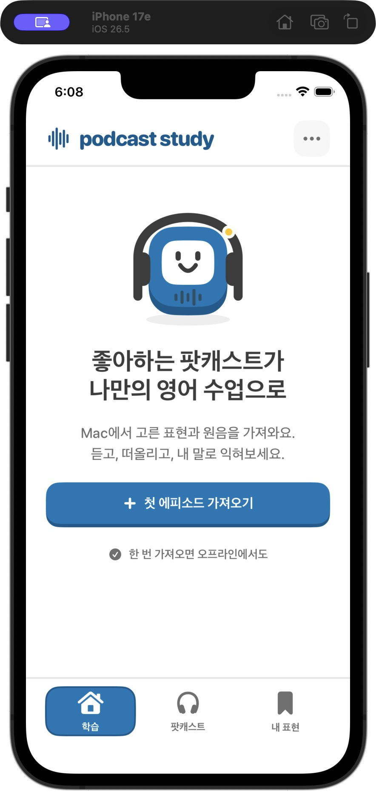

# Podcast Study 디자인 가이드

Duolingo의 밝고 둥근 학습 경험을 벤치마킹해, 내가 듣는 팟캐스트를 매일 연습하는 개인용 앱에 적용한다. **흰 배경·진한 하늘색·둥근 굵은 글자·단단한 버튼 아래쪽 면·명확한 다음 행동**을 공통 언어로 삼는다.

현재 앱의 첫 화면입니다. 실제 iOS Simulator 캡처이며, 학습 기록이 없는 상태입니다.

## 근거와 적용 범위

공식 자료에서 확인한 내용과 이 프로젝트가 정한 수치를 구분한다.

- Duolingo의 [core tabs 개편 글](https://blog.duolingo.com/core-tabs-redesign/)은 헤더 위치·글자 위계·간격을 탭 전체에서 맞추고, 목적 없는 그림과 컨테이너를 줄인 과정을 설명한다. 이 앱도 탭마다 같은 제목 위치와 여백을 사용하고, 실제 학습에 필요한 정보만 남긴다.
- [홈 학습 경로 설명](https://blog.duolingo.com/new-duolingo-home-screen-design/)은 다음 행동을 안내하고 신규 학습과 복습을 경로 안에 섞는 접근을 소개한다. 이 앱에서는 기존 오늘의 큐를 분명한 시작 버튼에 연결한다. Duolingo의 학습 효과가 이 앱에서도 입증됐다고 주장하지 않는다.
- [공식 사이트](https://www.duolingo.com/)가 직접 불러오는 [공개 웹 번들](https://d35aaqx5ub95lt.cloudfront.net/js/4779-0fb1dea3.js)에서 `owl`, `tree-frog`, `snow`, `polar`, `swan`, `macaw`, `bee`, `fox`, `cardinal`, `sea-sponge`, `iguana`의 아래 색상값을 확인했다. 이는 2026-10-28에 관찰한 웹 구현이며 전체 iOS 디자인 명세를 뜻하지 않는다. [앱 번들](https://d35aaqx5ub95lt.cloudfront.net/js/app-c4519c5a.js)의 `black-text`는 `#3C3C3C`다.
- 기존 `design.duolingo.com/identity/color`와 `/identity/typography` 주소는 확인 시 디자인 블로그로 이동했다. 원래 문서의 현재 상세 명세는 확인하지 못했다.

레퍼런스의 색상은 관찰 근거로만 남기고, 앱의 키컬러는 진한 하늘색으로 독립적으로 정했다. 아래 앱 팔레트·크기·간격·동작 시간은 **Podcast Study의 구현 제안값**이다. Duolingo의 로고·Duo 캐릭터·전용 폰트 파일을 사용하지 않는다. 앱의 그림은 헤드폰을 쓴 오디오 플레이어 캐릭터 `PodcastBuddy`로 직접 그린다.

## 1. 색상

| 토큰 | 값 | 역할 |
|---|---|---|
| `paper` | `#FFFFFF` | 기본 화면과 콘텐츠 면 |
| `surface` | `#F7F7F7` | 구분이 필요한 보조 영역 |
| `ink` | `#3C3C3C` | 제목·본문·주요 버튼 글자 |
| `muted` | `#6F6F6F` | 보조 설명. 이 프로젝트의 가독성 조정값 |
| `line` | `#E5E5E5` | 구분선·진행 트랙·외곽선 |
| `accent` | `#0077B6` | 주 CTA·현재 학습·진행 표시 |
| `accentDeep` | `#005A8D` | 하늘색 버튼의 아래쪽 면 |
| `accentTint` | `#E4F4FC` | 선택·완료 피드백 배경 |
| `blue` | `accent`와 동일 | 원음·듣기도 같은 키컬러 사용 |
| `blueTint` | `accentTint`와 동일 | 음성 버튼·보조 안내 면 |
| `yellow` | `#FFC800` | 완료 장식과 실제 성취 강조 |
| `orange` | `#FF9600` | 연습·주의 상태의 보조 표시 |
| `red` | `#FF4B4B` | 오류 아이콘·경계 등 제한된 강조 |

하늘색은 화면 전체를 칠하는 배경보다 **시작·계속·선택**에 집중한다. 빨강은 틀렸다는 처벌에 사용하지 않는다. `다시 연습`은 정상적인 학습 선택이다.

기본·음성 버튼과 선택된 모드·하단 탭은 모두 `#0077B6` 면에 **흰색 글자와 아이콘**을 사용한다. 흰색 글자와의 계산 대비는 약 4.87:1이다. 비활성 버튼은 회색 면과 회색 글자로 구분한다. 흰 면의 외곽선 버튼은 짙은 회색 글자를 유지한다. 보조 텍스트는 `#6F6F6F`를 사용하며, 색만으로 완료·선택을 전달하지 않고 아이콘과 문구를 함께 둔다.

## 2. 글자와 간격

- 기본 글꼴: `.system(..., design: .rounded)`. 영문과 한글은 OS가 제공하는 글꼴·한글 대체 글꼴을 사용한다. 특정 Duolingo 전용 폰트와 동일하다고 주장하지 않는다.
- 화면 제목 28~32pt / bold, 표현 30~36pt / bold, 섹션 제목 20~22pt / bold, 본문 17pt / medium, 버튼 16~17pt / heavy, 메타 정보 13~14pt / semibold.
- 한글 본문에 전부 대문자 스타일이나 과한 자간을 적용하지 않는다. 긴 표현과 에피소드 제목은 여러 줄을 허용한다.
- 화면 좌우 여백 20~24pt, 섹션 간격 24~28pt, 제목과 설명 8pt, 관련 조작 사이 8~12pt. 간격 기본 단위는 4pt다.
- 주요 콘텐츠 폭은 넓은 화면에서도 560pt 안쪽으로 유지한다. 작은 기기의 고정 높이로 문장이 잘리지 않도록 세로 스크롤을 제공한다.
- 본문과 주요 제목은 Dynamic Type에 따라 커지도록 구현한다. 버튼은 한 줄에 들어가지 않으면 세로로 쌓는다.

## 3. 버튼과 선택 상태

공통 `StudyButtonStyle`을 사용한다. 기본 모서리는 16pt, 버튼 최소 면 높이는 50pt이며 아래쪽 면에 4pt를 더 확보한다. 번진 그림자 대신 아래쪽의 진한 단색 면으로 누를 수 있음을 보여준다.

| 종류 | 면 | 아래쪽 면·외곽선 | 사용 |
|---|---|---|---|
| primary | 진한 하늘색·흰 글자 | 더 짙은 하늘색 | 학습 시작·답 확인·떠올렸어요 |
| secondary | 진한 하늘색·흰 글자 | 더 짙은 하늘색 | 원음 듣기·반복 |
| outline | 흰색 | 회색 | 다시 연습·보조 행동 |
| quiet | 투명 | 없음 | 닫기·설정·낮은 우선순위 |

눌렀을 때 면과 글자가 아래로 4pt 움직이고 아래쪽 면은 제자리에 남는다. 동작 줄이기 설정에서는 전환 애니메이션을 없앤다. 비활성 버튼은 회색으로 바꾸되 이유가 있으면 주변 문구로 설명한다. 비활성 상태에 눌림 효과를 주지 않는다.

버튼 스타일이 폭을 강제하지 않는다. `학습 시작` 같은 CTA는 화면에서 전체 폭으로 만들고, 반복·배속·북마크는 실제 역할에 맞는 폭을 쓴다. 한 화면에서 가장 눈에 띄는 CTA는 하나로 유지한다.

## 4. 카드·진행·내비게이션

**카드:** 학습 문장, 에피소드 선택처럼 묶음 자체가 기능일 때만 사용한다. 흰 면, 2pt 회색 외곽선, 20~24pt 모서리, 내부 여백 20~24pt가 기준이다. 모든 설명과 통계에 카드를 덧씌우지 않는다. 선택된 에피소드·모드는 하늘색 면과 체크·문구로 표시한다.

**진행:** 높이 16pt의 둥근 회색 트랙과 하늘색 막대, 얇은 밝은 하이라이트로 구성한다. 현재 카드 위치와 실제 평가한 개수는 구분한다. 넘겨 본 표현을 외운 표현으로 표시하지 않는다. 완료 문구도 `10개 중 3개 복습 기록`처럼 실제 기록을 말한다.

**하단 탭:** 오늘·에피소드·내 표현 세 목적을 유지한다. 각 탭의 아이콘과 짧은 한글 이름을 함께 제공하고 현재 선택은 색·배경/형태로 표현한다. 세 탭의 헤더와 여백을 맞춘다. Mac 미리보기에서는 플랫폼 탭 표현이 달라질 수 있다.

**상태 정보:** 소유하지 않은 보석·하트·가짜 연속 학습일을 장식으로 만들지 않는다. 등록한 표현 수·오늘 기록한 표현 수·북마크 수처럼 저장된 데이터에서 계산할 수 있는 값만 사용한다.

## 5. 화면별 UX

### 오늘

현재 상태 → 오늘 학습할 표현 → **학습 시작** 순서로 읽힌다. 신규/복습이 섞인 기존 큐를 사용하며, 친근한 `PodcastBuddy`는 학습 시작점이나 빈 상태를 안내할 때만 배치한다. 화면을 여는 사람에게 기능 목록이나 긴 광고 문구를 읽게 하지 않는다.

꾸러미가 없을 때는 `첫 에피소드를 가져와요`와 한 개의 가져오기 CTA를 보여준다. 오늘의 큐가 비었을 때는 완료 상태를 말하고 에피소드 복습이나 새 꾸러미 가져오기로 이어준다.

### 학습

상단은 닫기와 진행, 가운데는 한 표현의 과제, 아래는 답 공개나 평가 행동에 집중한다. 발견·듣기·말하기는 같은 표현을 다른 방식으로 연습하는 모드이며 각각 무엇을 할지 한 줄로 알려준다.

- 발견: 표현·뜻·실제 문장을 읽고 원음을 듣는다.
- 듣기: 영어 답을 가리고 원음을 직접 재생한 뒤 답을 확인한다.
- 말하기: 뜻만 보고 소리 내어 말한 뒤 답을 확인한다.
- 답 공개 후 `다시 연습`과 `떠올렸어요`를 제시한다. 평가를 눌렀을 때만 복습 기록이 변한다.
- 음성 재생·반복 대기·완료·중단은 아이콘에만 의존하지 않고 짧은 문구로 알려준다.
- 긴 원문·전체 해석·생성 연습 예문은 읽기 영역과 추가 맥락에서 분리한다. 실제 원문과 새 예문의 출처를 섞지 않는다.

### 에피소드·내 표현

에피소드 제목을 가장 먼저, 표현 수와 준비된 원음 수를 그다음에 보여준다. 저장소 관리와 백업 설명은 주 학습 흐름을 밀어내지 않도록 별도 메뉴/보조 영역에 둔다. 내 표현은 북마크를 다시 쓰게 해주는 공간이며 가짜 숙련도나 별점을 부여하지 않는다.

## 6. 움직임과 피드백

버튼 누름 100ms, 진행 변화 220ms, 답 공개 180~220ms를 기준으로 한다. 움직임은 눌렀는지·다음으로 넘어갔는지·새 내용이 나타났는지를 설명한다. 루프 애니메이션이나 끊임없는 캐릭터 흔들림을 기본으로 넣지 않는다.

- 평가 기록이 성공적으로 저장된 다음에만 다음 표현으로 이동한다.
- 파일 가져오기 중에는 상태를 표시하고 중복 가져오기·평가·재생 조작을 막는다.
- 음성이 없으면 `원문 음성 없음`과 실제 실패 이유를 보여준다. 합성 음성으로 조용히 대체하지 않는다.
- 가져오기·재생 오류는 구체적인 다음 행동과 연결한다. 오류를 학습 실패처럼 꾸미지 않는다.
- 완료는 짧고 긍정적으로 표현하되, 실제로 학습하지 않은 개수를 성취로 주장하지 않는다.

## 7. 적용·검수 기준

공통 코드는 `ios/PodcastStudy/App/StudyDesign.swift`의 `StudyStyle`, `StudyButtonStyle`, `StudyProgressBar`, `PodcastBuddy`다. 일반 텍스트는 `.studyFont`로 시스템 글자 크기에 맞춰 확대하고, 별도 `@ScaledMetric`을 쓰는 표현은 중복 확대하지 않는다. 화면에서 같은 역할에 다른 색상·모서리·글꼴을 직접 선언하지 않고 이 공통 규칙을 우선한다.

검수할 때는 390pt 폭, 큰 글자, 빈 상태, 원음 없는 카드, 긴 제목·문장, 답 가림/공개, 평가 전/후, 가져오기 중·실패·재시도를 함께 본다. 화면에서 한눈에 다음 행동이 보이고, 텍스트가 눌리거나 잘리지 않아야 한다.

Xcode 26.6과 iOS 26.5 Simulator에서 빌드와 화면 실행을 확인했다. 네이티브 파일 선택기로 실제 학습 꾸러미를 가져와 홈·하단 탐색·카드 화면을 점검했다. 물리적 아이폰의 스와이프 감도·오디오 중단·VoiceOver와 큰 글자 전체 조합은 추가 실기기 검수 항목이다. 실행한 검사와 범위는 [검증 기록](ios/VALIDATION.md)에 남긴다.
