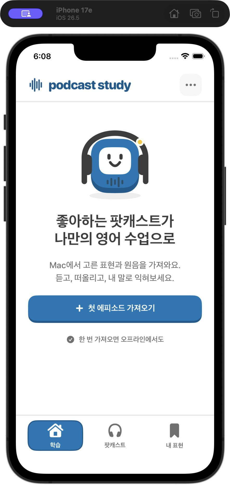
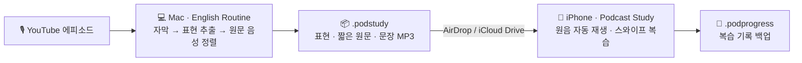

<div align="center">


# Podcast Study

**좋아하는 팟캐스트가 나만의 영어 수업으로**

내가 듣는 팟캐스트에서 회화 표현과 실제 발화를 골라,<br>
iPhone에서 원음으로 듣고 말하며 복습하는 개인용 영어 학습 앱


[iPhone 앱](ios/README.md) · [Mac 앱](macos/README.md) · [디자인 가이드](DESIGN.md) · [스와이프 UX](docs/SWIPE_UX.md) · [검증 기록](ios/VALIDATION.md)

</div>

---

## 왜 만들었나

영어 교재의 문장은 내 관심사와 멀고, 팟캐스트는 흘려듣고 나면 남는 표현이 없습니다.
Podcast Study는 **이미 즐겨 듣는 에피소드**를 학습 재료로 바꿉니다.

- 🎧 **진짜 발화로 익힌다** — 합성 음성 대신, 표현이 나온 원문 문장의 원음을 잘라 들려줍니다.
- 👆 **가볍게 복습한다** — 카드를 오른쪽으로 밀면 저장, 왼쪽으로 밀면 넘기기. 원음은 카드가 뜨면 자동 재생됩니다.
- ✈️ **어디서든 오프라인** — 한 번 가져온 학습 꾸러미는 서버·계정·Mac 연결 없이 동작합니다.
- 📈 **내 회화를 돌아본다** — 수업 스크립트를 분석해 실수 교정, 반복 실수, 회차별 변화를 보여줍니다.

<p align="center">
  
</p>

## 동작 방식



**Mac에서 준비 → `.podstudy` 파일로 전달 → iPhone에서 오프라인 학습**이 기본 흐름입니다.

## 주요 기능

<table>
<tr>
<th width="50%">💻 Mac — English Routine</th>
<th width="50%">📱 iPhone — Podcast Study</th>
</tr>
<tr valign="top">
<td>

- YouTube 영어 자막을 시간정보째 가져와 회화 표현 **10·20·30개** 추출
- 표현이 담긴 원문 한 문장을 단어 단위로 정렬해 **실제 MP3 클립** 준비
- 원문 문장 한글 해석, 표현 보관함, 오늘의 표현 복습
- **회화 리포트**: 실수는 빨간색, 고친 표현은 녹색 형광펜으로 표시하고 수업 단어 정리
- 지난 수업 개선점 · 자주 틀리는 표현 카드 복습 · 이번 주 루틴 캘린더
- 아이폰용 **학습 꾸러미 내보내기**

</td>
<td>

- **오늘**: 기한이 된 복습 + 새 표현을 섞어 최대 10장
- **에피소드** 순서대로 연습, **내 표현**으로 저장한 것만 모아보기
- 화면에 보이는 구절 범위만 정확히 재생하는 **원음 자동 재생**과 작은 다시 듣기
- 오른쪽 스와이프 = 저장, 왼쪽 = 넘기기 (암기 성공으로 기록하지 않음)
- VoiceOver 사용자 지정 동작, 큰 글자, 동작 줄이기 고려
- `.podprogress`로 복습 기록 백업·복원

</td>
</tr>
</table>

## 빠른 시작

**1. Mac 앱 빌드** — `~/Applications/English Routine.app`이 만들어집니다.

```bash
python3 macos/setup_download.py
```

```bash
python3 macos/build.py
```

필요 도구: Python 3, Deno, ffmpeg, 로그인된 Codex CLI. 자세한 내용은 [Mac 앱 안내](macos/README.md)를 참고하세요.

**2. iPhone 앱 설치** — 전체 Xcode에서 `ios/PodcastStudy.xcodeproj`를 열고, 본인 Apple 계정 Team으로 서명한 뒤 기기에서 실행합니다. 단계별 안내는 [iPhone 앱 안내](ios/README.md)에 있습니다.

**3. 학습 꾸러미 옮기기** — Mac의 팟캐스트 학습 → 에피소드 선택 → **아이폰 학습 꾸러미 만들기** → **꾸러미 저장**. 만든 `.podstudy` 파일을 AirDrop이나 iCloud Drive로 아이폰에 보내 앱에서 가져옵니다.

## 검사

```bash
# 로컬 테스트 · 프로젝트 검사 · Swift 핵심 로직 · 공유 화면 타입 검사
python3 ios/verify.py
```

```bash
# 전체 Xcode / iOS Simulator SDK가 있을 때 iOS 빌드까지 필수로 검사
python3 ios/verify.py --require-ios
```

현재 환경에 iOS SDK가 없으면 검사 결과에 이를 명시하며, 소스 검사를 iOS 실행 검증으로 표시하지 않습니다.

> [!NOTE]
> iOS Simulator 빌드와 시뮬레이터에서의 파일 가져오기는 확인했지만, **본인 아이폰에 서명·설치하는 단계와 실기기 동작(스와이프 감도, 오디오 중단, 접근성)은 아직 검증하지 않았습니다.** 확인 범위는 [검증 기록](ios/VALIDATION.md)에 정리되어 있습니다.

## 프라이버시

- 서버·계정·클라우드 동기화가 없습니다. 학습 데이터는 Mac과 iPhone 각자의 로컬 저장소에 있습니다.
- `.podstudy`에는 계정 토큰, Codex 설정, 전체 전사, 전체 원본 녹음을 담지 않습니다.
- 회화 리포트는 본인 발화와 분석 결과만 저장하며, 상대 발화와 원본 스크립트 전체는 저장하지 않습니다.
- 표현 추출·회화 분석은 로그인된 Codex CLI를 실행하므로 해당 계정 사용량을 소비하고 인터넷 연결이 필요합니다.

## 프로젝트 구조

```text
speaking-with-podcast/
├── macos/          # English Routine: AppKit + WKWebView 셸, 로컬 Python 서버, 웹 대시보드
│   ├── server.py           # 로컬 API (토큰 · Host/Origin 검사)
│   ├── study_pack.py       # .podstudy 내보내기
│   ├── audio_clips.py      # 원문 문장 MP3 클립
│   ├── align_words.py      # 단어 단위 음성 정렬
│   ├── conversation_report.py
│   └── web/                # 대시보드 · 팟캐스트 학습 · 회화 리포트 화면
├── ios/            # Podcast Study: SwiftUI iPhone 앱
│   ├── PodcastStudy/       # App · Core · Resources
│   ├── Tests/ · Checks/    # Swift 핵심 로직 테스트
│   └── verify.py           # 통합 검사
├── docs/           # 스와이프 UX · 캐릭터 명세 · 설계 문서
├── DESIGN.md       # 색상 · 글자 · 버튼 · 학습 UX 규칙
└── dist/           # 이전 웹 대시보드 (현재 개발은 macos/ · ios/)
```

## 디자인

흰 배경, 진한 하늘색(`#0077B6`) 키컬러, 둥근 굵은 글자, 단단한 버튼 아래쪽 면, 명확한 다음 행동을 공통 언어로 삼습니다. 하늘색 봉제 인형 질감의 학습 친구는 홈·빈 상태·완료 화면에서 호흡하고, 터치하면 짧게 인사합니다. 자세한 규칙은 [디자인 가이드](DESIGN.md)와 [캐릭터 명세](docs/design/COMPANION.md)를 참고하세요.

---

<p align="center"><sub>개인 학습용 프로젝트입니다. 개인 학습 꾸러미 · 음성 · 복습 기록은 저장소에 커밋하지 않습니다.</sub></p>
